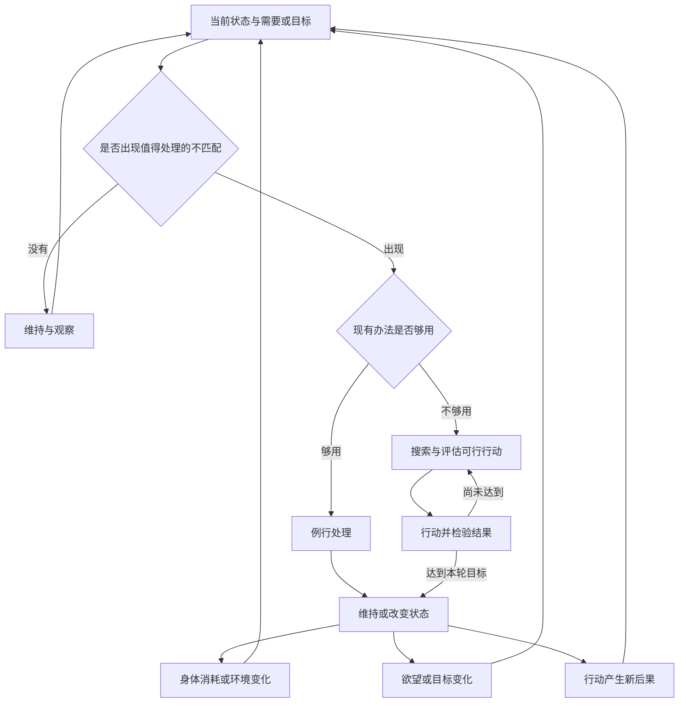

# 存在、需要、欲望与问题循环

人的身体依赖一定条件持续存在，身体调节、感受与生活经验参与塑造欲望；需要或目标与现实条件不匹配时，可能形成问题，行动又会改变下一轮需要、目标与约束。

这是一套解释问题如何反复生成的概念框架。它不以“人的欲望必然无限”为前提，也不把所有问题都还原为欲望。

## 核心区别：存在、需要与欲望

| 概念 | 本页采用的含义 | 例子与边界 |
| --- | --- | --- |
| 身体存在 | 作为生命系统持续运行，依赖物质、能量与环境条件 | 身体睡眠时仍在进行生理调节 |
| 生理需要 | 维持生命或某项身体功能所需的条件 | 缺乏某种营养可能已经造成损害，但本人尚未察觉 |
| 自我调节 | 已有机制对变化作出反应，使相关状态维持在一定范围 | 体温等生理调节不必每次由有意识愿望启动 |
| 感受 | 身体或处境以舒适、不适、饥饿、口渴等形式进入经验 | 感到不适，不等于已经知道原因或处理办法 |
| 欲望 | 主体体验到的“想要”，可能指向取得、保持或避免某种状态 | 想喝水、想保住工作、想获得认可 |
| 目标 | 被选择或表述为行动方向的状态 | 欲望可能尚未形成明确目标，目标也可能来自承诺或规则 |
| 约束 | 限制行动可能性及成本的条件 | 自然条件、资源、社会规则、他人行动、知识和能力 |

这里把“欲望”限定为有感受的想要，便于讨论它与身体需要的关系。心理学和哲学也会使用“无意识欲望”或更宽泛的动机概念；采用其他定义时，需要重新说明边界。^[ambiguous]

生理需要与欲望并非一一对应：需要可以尚未进入意识，欲望也可能指向无益于身体的对象。具体欲望还受到记忆、判断、想象和社会经验影响，可与 [[wiki/concepts/Belief and Attitude|信念与态度]] 的形成机制连读。

## 人的存在和欲望哪个先有

“先有”至少包含三种不同关系。

| 问题 | 可以作出的判断 | 不应越过的边界 |
| --- | --- | --- |
| 条件上的依赖 | 一个人有意识的欲望依赖已有身体及相应能力；许多生命维持过程可以在没有有意识愿望时运行 | 身体存在本身不能解释为什么产生某个具体欲望 |
| 发展上的先后 | 生命调节在演化上早于有意识的欲望；个人的具体欲望也随着能力与经验发展 | 不据此指定胎儿或婴儿产生体验的精确时点 |
| 哲学上的根本性 | 可以讨论意志是否比物质表现更根本 | 这是形而上学立场，不等于“一个人先想出生，再创造身体” |

对于问题生成模型，最有用的是条件上的依赖：**身体不必先形成“我想活着”的念头，才开始维持生命。** [[wiki/concepts/Life as Dissipative Information Structure|生命作为耗散信息结构]] 提供了自我维持的物理背景；由此不能直接推出系统具有主观欲望。

如果把一切维持自身、趋近有利条件的活动都称为“欲望”，那么“生命与欲望同时出现”部分来自定义选择，不能作为发现主观体验起源的证据。

## 从需要到想要：不能省略的门槛

“缺水会损害身体”描述的是生存条件与后果，“我想喝水”描述的是主体状态。前者不能仅凭逻辑就推出后者。

```text
持续存在依赖条件
        |
        | 已有的生理机制
        v
身体检测变化并进行调节
        |
        +----> 不必进入意识的调节过程
        |
        +----> 部分变化与口渴、饥饿、不适等感受相关
                              |
                              | 解释、记忆、想象与社会经验
                              v
                         具体的想要与目标
```

这幅图表达依赖关系与候选解释层次，不是每一种欲望都必经的固定流水线。欲望也可以由对未来的想象或社会经验唤起，无须先出现可识别的即时生理缺口。

必须分别解释三层结构：

1. **存在条件**：系统依赖什么才能继续运行。
2. **调节机制**：系统如何对条件变化作出反应。
3. **主观体验**：变化为什么、怎样被体验为好坏或想要。

恒温器能检测温差并启动加热，但仅凭这些功能，不能断定它体验到冷或想要温暖。同样，生命自我调节的功能描述，也不能单独完成对主观体验的解释。

把感受与生命调节相联系，是达马西奥等研究者的重要理论方向；从生理调节到意识体验的完整解释仍存在争议。^[ambiguous]

## 问题怎样产生

“欲望与现实有差距”提供了一个入口，但需要进一步区分问题的层次。

| 层次 | 判断依据 | 例子 |
| --- | --- | --- |
| 问题处境 | 需要已经受损，或相关目标受到阻碍 | 已发生但尚未察觉的营养不足 |
| 被察觉的问题 | 主体意识到不适、偏差或行动受阻 | 知道自己饿了，也发现眼下没有食物 |
| 需要求解的任务 | 现有办法不足，需要寻找、评估或执行可行路径 | 资源不足时，必须重新安排如何取得食物 |

这里的“需要求解”着重指需要重新寻找或组织办法的情况；形式化问题求解也可以把熟练操作描述为一个已知解的任务。该区分用于诊断认知负担，不是统一各学科术语。^[inferred]

如果饭已经在桌上，饥饿与饱腹之间仍有差距，但熟悉的行动就能处理。相同的客观局面对熟练者和新手可能产生不同的求解负担。[[wiki/concepts/Nature of a Question|问题的本质]] 主要解释主体意识到的模型与行动缺口；本页同时保留尚未被意识到的问题处境。

“无限欲望”不是问题产生的必要条件：一个人只有“今天获得足够饮水”这一有限目标，水源中断时也会遇到问题。目标也可以是维持健康、保住住所或避免损失，不必总是取得一个全新的状态。

约束还需要分清来源。歉收与“食物存在但本人无法取得”，会产生相似的饥饿处境，却要求不同的机制解释。参见 [[wiki/concepts/Hard Constraint|现实约束]]；现实中有效的限制，不都具有自然定律那样的不可改变性。

## 解决之后为何还会出现下一轮

解决问题改变当前状态，但身体、环境、目标和能力仍会变化。下一轮至少有三种来源。

| 循环来源 | 哪个量变化 | 例子 |
| --- | --- | --- |
| 原需要再次出现 | 身体或环境偏离了原来的可接受范围 | 吃饱后继续消耗能量，随后再次饥饿 |
| 目标提高或改变 | 希望达到的状态变化 | 程序已经能运行，随后希望运行得更快 |
| 解决方案产生新后果 | 行动改变了条件、责任或约束 | 买车解决出行问题，也带来停车与保养需求 |



图中的判断表示分析者对过程的区分，不假定每个环节都由有意识思考执行。

**循环不等于欲望无限扩张，也不自动证明前一次解决失败。** 明天再次饥饿，不会取消今天这顿饭的作用；发现更深的问题，也不会取消已经获得的能力。

这里需要用 [[wiki/concepts/Feedback Loops|反馈回路]] 区分纠偏、目标上移与后果回流。反复维持某个范围可以是有效的负反馈，持续抬高满足标准则需要另行检查其来源和代价。

## 使用这个框架时先问什么

把上述区别作为 [[wiki/concepts/Mechanism Model|机制模型]] 的检查步骤，可以避免把一切困难归因于欲望过多。^[inferred]

1. 当前需要被维持的条件是什么？它与本人说出的欲望是否一致？
2. 希望取得、保持或避免的状态是什么？是否具有可辨认的满足界限？
3. 阻碍来自自然条件、社会安排、知识不足，还是行动能力不足？
4. 这是已经发生的问题处境、被察觉的问题，还是需要重新求解的任务？
5. 下一轮重复的是同一种需要，还是目标与行动后果已经改变？

这组问题帮助定位机制，本身并不决定“应该改变世界还是调整欲望”。后一个判断仍需考虑可行性、价值、责任与代价。

## 思想来源与证据边界

本页的直接来源是 2026-09-25 的圆桌式概念讨论。人物发言属于基于思想体系的模拟，不能视为人物原话；以下著作只作为后续核对线索，本次未逐段核验。

| 思想线索 | 用于提出的区分 | 后续核对书目 |
| --- | --- | --- |
| 叔本华 | 某个欲望被满足与欲求活动终止不同；根本意志与日常愿望不同 | 《作为意志和表象的世界》 |
| 伊壁鸠鲁 | 有自然限度的需要与被意见扩大的欲望不同 | 《致美诺伊克斯书》 |
| 马克思 | 需要与满足方式具有社会历史条件；自然阻碍与社会关系应分开分析 | 《德意志意识形态》《资本论》 |
| 西蒙 | 目标、当前状态、可用行动与有限能力共同影响求解负担 | 《人工科学》及问题求解研究 |
| 达马西奥 | 生命调节、感受与意识需要分层解释 | 《笛卡尔的错误》《事物的奇异秩序》 |

这些线索在本页组成分析框架，不表示上述作者共同提出或认可同一套理论。^[inferred]

尚未解决的问题包括：主观欲望如何从身体活动中出现；怎样区分扩大行动空间的循环与增加依赖的循环；何时调整目标，何时改造阻碍目标的条件。^[ambiguous]

## 原始草稿

- [[wiki/sources/人生的问题循环]] — 保留“需要、欲望、约束与行动反复生成问题”的本地原始表达；本页进一步区分了这些概念。

## Related

- [[wiki/concepts/Life as Dissipative Information Structure|生命作为耗散信息结构]]：生命持续运行所需的物理背景。
- [[wiki/concepts/Nature of a Question|问题的本质]]：从需要受阻推进到被意识到的认知与行动缺口。
- [[wiki/concepts/Belief and Attitude|信念与态度]]：经验、判断与评价如何参与行动倾向的形成。
- [[wiki/concepts/Hard Constraint|现实约束]]：具体行动空间与限制来源。
- [[wiki/concepts/Feedback Loops|反馈回路]]：维持、放大与后果回流的区别。
- [[wiki/concepts/Mechanism Model|机制模型]]：把反复出现的问题写成可检查的生成结构。
