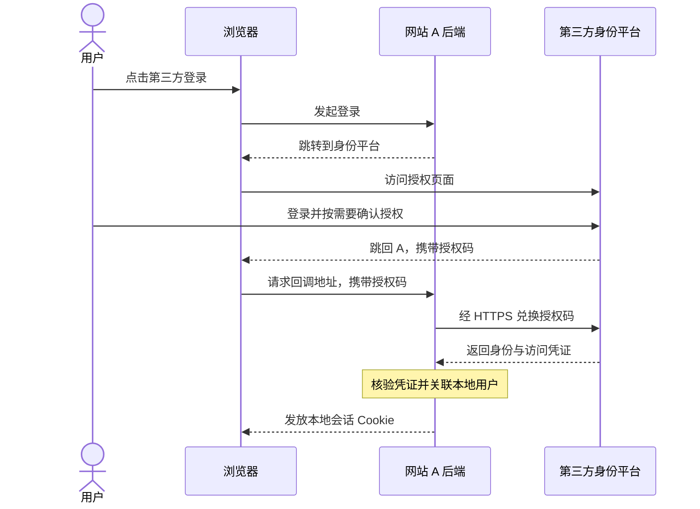

# 第三方登录认证

第三方登录认证是一种由外部身份平台确认用户控制着哪个账户、当前网站核验结果并建立本地登录状态的机制。网站事先选择信任某个平台，同时验证每次返回的身份结果。

## 身份确认与业务权限分开

“使用 Google 账号登录网站 A”让用户少维护一套密码。用户在身份平台自己的页面完成登录，A 获得身份结果，通常不会获得用户的第三方账户密码。

平台确认的是账户身份，不自动证明现实中的实名身份。A 把外部账户关联到自己的用户记录后，仍需依据本地规则决定会员资格、管理员权限和内容访问范围。

相关协议和凭证各有职责：

| 名称 | 主要职责 | 边界 |
|---|---|---|
| OAuth 2.0 | 让应用取得访问特定资源的许可 | 单靠 OAuth 授权并未定义完整的用户身份认证 |
| OpenID Connect（OIDC） | 在 OAuth 之上提供标准化身份认证 | 不替网站决定本地业务权限 |
| 授权码（Authorization Code） | 临时兑换凭证，通常短时且只能使用一次 | 网站不能仅凭它或回调中自称的用户信息建立登录状态 |
| ID Token | 表达身份平台认证后的用户身份及相关声明 | 必须核验来源、接收对象、有效期和请求关联信息 |
| Access Token | 调用被许可的资源接口 | 不能直接当作发给网站的身份声明来使用 |
| 本地会话 Cookie | 让后续请求携带网站自己的登录会话 | 它与第三方平台的登录状态是不同对象 |

其他平台也可能通过专用身份接口实现第三方登录，接口名称和返回字段以对应平台文档为准。

## 授权码怎样变成本地登录状态

以采用 OIDC 授权码流程的网站 A 为例，A 先在身份平台登记应用和允许的回调地址。用户点击登录后，浏览器前往身份平台，请求中注明应用身份、回调地址和申请权限。

平台验证用户，或使用已有登录状态，并按需要让用户确认申请的权限。通过后，浏览器带着授权码回到 A 的回调地址。浏览器负责传递这个码，A 不能直接相信回调参数中宣称的身份。

A 的后端经 HTTPS 向平台兑换授权码。机密客户端通常还需要验证应用身份；PKCE 用本次请求生成的秘密，将兑换动作绑定到登录发起方。平台检查码是否有效、是否已使用，以及是否属于这个应用和回调地址。

在 OIDC 中，兑换结果包含 ID Token。A 验证身份结果后，以签发者和稳定用户标识（`iss`、`sub`）关联或创建本地用户，再建立自己的登录会话。后续访问 A 通常使用 A 的会话 Cookie，无需每次重新登录第三方平台。

## 信任建立在可核验的结果上

网站需要事先认可身份平台，并核验每次收到的凭证。以平台使用公钥签名的 ID Token 为例，A 使用受信任平台的公钥验证签名，并检查以下条件：

- `iss`：凭证来自预期的身份平台。
- `aud`：凭证发给当前应用。
- `exp`：凭证仍在有效期内。
- 请求关联信息：按所用流程检查 `nonce` 等信息，确认结果对应本次登录。

HTTPS 保护与平台的通信；签名帮助验证身份凭证的真实性；`state` 等请求关联机制用于把回调与此前发起的登录对应起来。PKCE 使截获授权码的人更难冒用兑换。各机制保护不同环节，不能用“已经有一个 token”代替完整核验。

从 [[wiki/syntheses/信息流与状态流转设计原则|信息流与状态流转]] 看，外部身份结果先作为需要核验的信息进入系统，核验通过才触发本地会话建立。身份声明的传播和本地登录状态的变化，是两段有明确边界的过程。^[inferred]

## 使用与实现时的判断抓手

用户应先确认登录页面属于真正的身份平台，再检查网站申请了哪些权限。能登录 A，不意味着 A 获准读取所有第三方数据，也不意味着用户自动取得 A 的高级权限。

接入时应使用成熟协议库完成凭证核验和请求关联，用身份提供方与稳定用户标识关联本地账户，不把昵称当作唯一身份。具体平台是否使用 OIDC、专用身份接口或其他协议，需要查看它的文档；本页记录通用机制，没有核验某个指定产品的接口实现。

## Related

- [[wiki/maps/CS Map]] — 软件架构与计算机科学知识入口。
- [[wiki/syntheses/信息流与状态流转设计原则]] — 区分外部声明的传递与本地状态的合法变化。
