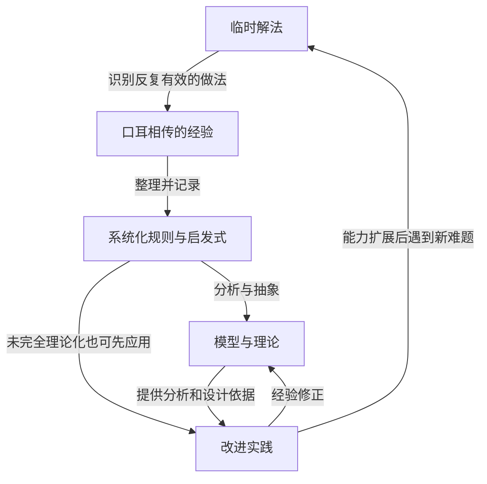

# Prospects for an Engineering Discipline of Software Source Guide

> 来源：Mary Shaw，*Prospects for an Engineering Discipline of Software*，1990 年 9 月，CMU/SEI-90-TR-20。本文页码指报告印刷页码；用户提供的 PDF 共 33 页，包含封面、目录、空白页和报告信息页。

## 核心问题：工程能力怎样成为职业的日常能力

Shaw 检验的是“软件工程”这个名称背后的实际能力。在她的历史叙述中，1968 年的软件工程会议把这个词作为愿望式口号；随后，生命周期、成本估算、配置管理、质量保证和文档框架让大规模开发更有秩序。但这些生产能力是否已经等于一门工程学科，需要另外论证。

报告把工程界定为：应用科学、数学和设计分析，在相互冲突的需求与约束下，为真实使用者建造经济可行的解决方案。判准不仅是系统能否运行，也包括成本、资源、使用价值，以及先前解法能否帮助后来的从业者。（§1，pp. 1–3）

核心承诺是让具有普通才干的专业者（ordinary talent），借助组织好的知识，可靠地完成复杂设计。少数高手的成功说明问题可以被解决；只有成功的方法能被查找、理解、选择和复用时，这种能力才开始成为职业的共同能力。

> [!note] 时间边界
> “软件尚未普遍成为真正的工程学科”是 Shaw 对 **1990 年**的诊断。本文保存她的判准和论证，不据此直接判定今天整个软件行业的成熟程度。

## 概念结构：三个阶段与两类设计

报告提出一条从工艺到工程的演化模型。它解释各阶段增加了什么能力，不是一个自动发生的升级时间表。（§1.2，pp. 3–5）

| 阶段 | 主要支撑 | 能力与缺口 |
| --- | --- | --- |
| 工艺（craft） | 才干、直觉、试错和零散经验 | 能解决问题，但知识传递缓慢，常需重复发明 |
| 商业生产（commercial practice） | 训练、既定程序、管理、成本控制 | 能持续组织生产；知道程序有效，未必充分理解原因 |
| 专业工程（professional engineering） | 成熟科学与实践结合，知识可用于分析和设计 | 能比较约束与方案，把有效解法用于常规问题，并扩展可设计范围 |

管理和资源组织是必要条件。专业工程进一步要求科学足够成熟，能够描述真实问题，并以从业者可以操作的形式进入设计。

与阶段模型相配的是两类设计：

- **常规设计（routine design）**：解决熟悉的问题，复用先前解法的大部分。它仍包含适配和选择，不等于照抄代码或重复制造同一件产品。
- **创新设计（innovative design）**：为陌生问题寻找新解法，仍然需要优秀设计者。

Shaw 认为，当时软件开发把过多本可常规化的工作当成原创任务。提升生产率的一条路径是识别这些任务，并建立支持它们的知识与工具。（§1.1，pp. 2–3；§4.3，pp. 18–19）

## 历史对照：理论与经验怎样进入工程

### 土木工程：有理论以后，仍要跨过应用尺度

大型建筑早于成熟的结构理论。按报告的历史概括，工匠先积累经验规则，静力学与材料强度研究随后为受力合成、梁的弯曲提供解释。理论出现并不立即带来真实建筑尺度的设计能力。

Shaw 用两个节点说明这一距离：1742–1743 年圣彼得大教堂穹顶裂缝的分析，以及 1850 年不列颠尼亚管桥的结构分析。她也指出，早期穹顶模型没有正确处理弹性。这个对照支持的是：理论还须经过模型完善、材料数据整理和规模应用，才能成为可靠设计依据；它不保证每次理论应用都已正确。（§2.1，pp. 7–8）

### 化学工程：先发现跨产品重复的操作

化学工程的组织方式不同。工业碱生产先于解释其反应的成熟原子理论，实验室中能发生反应也不意味着工厂能够经济地大规模生产。

1880 年代，碱业监察员 G. E. Davis 从多家化工厂中辨认出反复出现的功能操作，如过滤、换热、蒸馏、筛分和分离。产品虽多，所需操作可以归为较少的类别；这些后来被称为 **单元操作（unit operations）**。化学工程把这些经验识别出的高层功能放入定量分析，考虑材料、设备、规模与操作的组合。（§2.2，pp. 8–10）

两门工程的对照防止把“科学基础”理解成唯一的一条自上而下演绎路径：实践可以先建立可复用分类，理论也可以先提供解释。最终都需要把知识变成可用于现实设计的依据，而不是让理论和生产各自发展。

## 软件史怎样支持诊断，而不只支持乐观类比

软件的经济与社会重要性首先说明，软件问题值得按工程问题处理。报告引用的 1989 年全球软件销售估计约为 **650 亿美元**，且不含更大的内部开发活动；软件已进入通信、航空、医疗成像和科学计算。失败的损失包括超支、延期和系统不可用，也包括积压太大而被放弃的需求。这是当时的规模材料，不是当前市场数据。（§3.1–3.2，pp. 11–12）

随后，Shaw 区分研究注意力的三个阶段：（§3.3，pp. 12–14）

1. **任意方式编程**：首先设法让程序运行，算法、数据与控制流尚常混在一个具体程序中。
2. **小规模编程**：把算法、数据结构和逻辑规格抽离出来，对单次执行、最终终止的程序进行分析。
3. **大规模编程**：处理持续运行的系统、长寿命数据、复杂状态、接口、团队协作与维护。

这不是产业成果出现的严格顺序。1950 年代的 SAGE 防空系统和 1960 年代的 Sabre 订票系统，在相应软件科学成熟前已经成功建成。报告将其成功归于优秀工程师对需求的理解和从其他工程领域借来的纪律；这些案例同时说明，杰出团队的能力可以领先于职业知识的普及。

因此，Shaw 把当时大量生命周期、估算、文档、配置管理与质量保证技术定位为商业生产阶段，认为 **software management（软件管理）**是更准确的描述。它们能组织人做事，却还没有充分回答每个设计决策应如何依据成熟知识作出。

算法、数据结构和编译器构造则是软件内部的正例。它们经历从个别程序中的解法，到独立抽象、正确性和性能分析，再到语言支持及解析器生成工具的过程，开始让好实践成为常规。报告从这些案例观察到约二十年的成熟过程；这一时长不能被当作所有技术的固定规律。（§3.4.1，pp. 14–15）

## 推理机制：知识编纂循环

Shaw 的 **codification cycle（知识编纂循环）**解释局部成功怎样变成可累积的职业知识。这里的 codification 指把零散经验整理、记录和组织为可共享规则，不只是写程序，也不必一开始就达到严格数学形式化。（§3.4.2，pp. 15–16）

图中的箭头表示知识如何被加工或反馈，不代表每个项目都须完成所有阶段。经验规则在完整理论出现前就可能有用；理论形成后，实际使用又能推动其修订。

控制流是报告给出的完整例子：早期程序员用测试与跳转指令逐次搭结构，重复实践筛出较可靠的模式，高级语言将它们写成条件与循环语法，形式结果和语义研究再支持推理与改进。后来的程序员直接使用这些构造，不必为每段程序重新发明循环。

这个循环与 [[wiki/concepts/Knowledge Formalization Gradient|知识形式化梯度]] 的连接在于经验可以逐渐获得精确表达；区别在于 Shaw 还要求知识回到设计现场并接受反馈。表达变严密和实践变可靠是相连但不同的两个问题。^[inferred]

## 让知识在设计现场可用

### 复用的单位大于代码

报告中的一位化工转行者比较了两种工作：设计换热器时能查到常数和标准方程，写软件时却常因无人记得旧解法而重新创造。他所期待的是软件领域的 **Perry 手册**，不只是算法和代码库，还包括可证明有效的设计，以及在多个备选方案之间选择的方法。（§1.1，p. 3）

Shaw 指定的内容包括设计元素、组件、接口、交换表示和算法，并要求它们配有分析技术或选择准则。她举出 Martin 排序综述的一页选择流程图，以及 Cody 与 Waite 关于初等数学函数实现的手册：后者保存基本策略及适配不同硬件时需要考虑的条件。（§4.3，p. 19）

这些例子说明，参考资料的作用不只是回答“过去写过什么”，还要帮助回答“当前约束下应该选什么”。

### 记忆、查阅与推导把成本放在不同位置

专业能力既包括推理技能，也包括事实、惯用法、应用知识和使用情境。报告区分三种获取知识的方式：（§4.1–4.2，pp. 17–18）

| 方式 | 职业共同体的基础设施成本 | 个人初始学习成本 | 使用时成本 |
| --- | --- | --- | --- |
| 记忆 | 低 | 高 | 低 |
| 查阅 | 高 | 低 | 中 |
| 推导 | 中到高 | 中 | 高 |

这是一张定性成本表。查阅把大量整理成本前移给共同体，推导则在每次应用时重新耗费精力；可用参考资料和教育习惯共同决定工程师如何分配努力。

### 五项议程分别补什么缺口

| 议程 | 要解决的缺口 |
| --- | --- |
| 理解专业知识的内容 | 明确除了通用推理能力，还必须掌握哪些事实、设计词汇和使用情境 |
| 承认多种知识获取方式 | 投资参考资料，避免把可查的知识一律重新推导 |
| 鼓励常规设计 | 在教育和职业激励中奖励案例阅读、已有解法的选择及参考资料的制作 |
| 承认专业分化 | 同时支持通信、可靠性、实时等内部专业，以及需要应用领域双重知识的外部专业 |
| 加强研究与商业实践互动 | 让研究者接触真实复杂系统，并把研究结果转化为生产环境可用的组成部分 |

软件手册应当在线、可交互、快速更新并接入设计工具，但这些要求同时带来内容验证、组织搜索、分发和贡献回报等问题。报告因此没有把知识基础设施缩成“多写文档”。（§4，pp. 17–20）

## 适用边界与开放问题

- 这是历史比较与议程性报告，不是对所有工程领域进行严格因果识别的研究。它提供诊断结构，不能保证每个领域都按相同次序发展。^[inferred]
- 常规设计适用于可辨认的熟悉问题；报告保留创新设计的必要性，也要求专业化保留计算机科学与应用学科基础。
- 经验编纂可以先于完整理论，但传播范围和文档数量不能证明经验可靠。将它用作组织改进方法时，还应记录依据、适用条件、失败情况和修订机制；这些是从报告延伸出的操作要求。^[inferred]
- 报告提出在线手册需要验证与组织，但没有给出一套完整的内容治理制度；如何维护过时知识、裁决相互冲突的经验，仍需补充来源。
- 对当前团队的可迁移提问是：一次成功是否改变了后来的人可以使用的设计知识？这可与 [[wiki/topics/Modern Software Engineering|现代软件工程]] 的反馈实践、[[wiki/syntheses/Knowledge System Construction|知识体系构建]] 的经验外化相连，但这些连接不等于 Shaw 在 1990 年已论证了今天的具体工具或工作流。^[inferred]

## Related

- [[wiki/topics/Modern Software Engineering]] — 比较“采用科学方法解决问题”与“科学知识成为常规职业能力”这两种工程判准。
- [[wiki/concepts/Knowledge Formalization Gradient]] — 区分知识表达逐渐精确化与知识回到实践接受检验。
- [[wiki/syntheses/Knowledge System Construction]] — 连接经验外化、可检索知识和场景复用。
- [[wiki/maps/CS Map]] — 计算机科学、架构与软件方法入口。
- [[wiki/maps/Reading Map]] — 原文阅读与来源指南入口。

## Sources

- [原报告 PDF（SEI）](https://www.sei.cmu.edu/documents/1010/1990_005_001_299270.pdf)。书目信息以报告封面为准：CMU/SEI-90-TR-20；URL 文件名中的数字不是报告编号。
- [完整中文拆书笔记](/Users/zenk/Context/20260920T232955--拆书-prospects-for-an-engineering-discipline-of-software__book.md)。来源主张据此前全文阅读与这份笔记整理；当前捕获不重新评估 1990 年的历史与市场数据。
